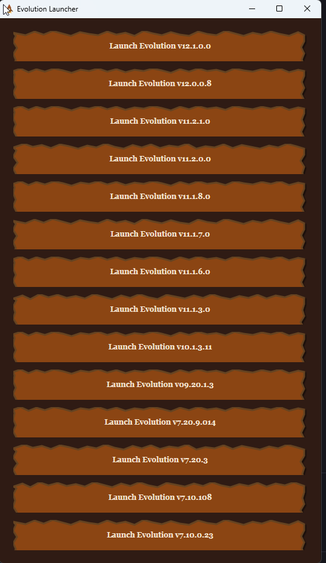

# Evo Launcher

A small Windows app that finds every installed version of Evolution (`evolution.exe`) and gives you one button per version, so you can launch the one you need.



## Features

- Scans `C:\Program Files (x86)\` recursively for `evolution.exe`.
- Reads each executable's file version and lists the versions newest first.
- Ignores duplicate copies of the same binary (matched by MD5), keeping the one closest to the install root.
- Launches the selected version from its own working directory.
- Disables the button for any version that is already running.
- **Right-click a button** to give that version a custom name. Custom names are saved in `custom_versions.json` next to the launcher.

## Requirements

- Windows 10/11 x64
- [.NET 9 Desktop Runtime](https://dotnet.microsoft.com/download/dotnet/9.0)

## Usage

Run `EXE\EvoLauncher.exe`, then click **Launch Evolution vX.X.X.X** for the version you want.

## Building

```
dotnet publish -c Release
```

This produces a single-file `EvoLauncher.exe` in the `EXE` folder.

## License

See [LICENSE](LICENSE).
